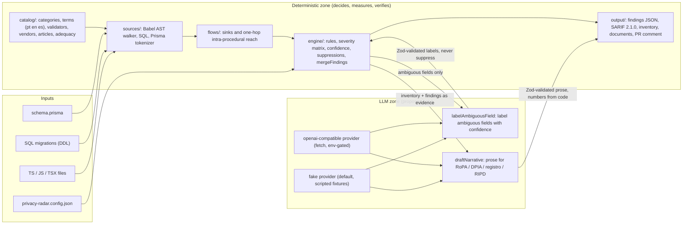

# privacy-radar

Scans a Node/TypeScript repository for a personal-data inventory and risky flows, maps every finding to exact LGPD and GDPR articles, drafts the RoPA, DPIA, registro and RIPD documents and explains pull requests as compliance sentences.

[](https://github.com/flaviorg/privacy-radar/actions/workflows/ci.yml)

**MIT** · **Node 24.21** · **drafts, not legal advice**

This repository shows what AI engineering looks like when the model is the least trusted component: a hard boundary, a property-tested merge, injection fixtures, a measured deterministic classifier, an offline eval harness and a live eval you can run with one key. Start with [`tests/unit/merge-findings.unit.test.ts`](tests/unit/merge-findings.unit.test.ts) and [`tests/e2e/injection.e2e.test.ts`](tests/e2e/injection.e2e.test.ts).

## The problem

LGPD art. 37 and GDPR art. 30(1)(a)-(g) require a record of processing that the code never produces: the inventory lives in migrations, models and handlers, while the record is written elsewhere, and the penalties are real (LGPD art. 52 II: a fine of up to 2% of revenue, capped at R$ 50,000,000.00 per infraction; GDPR art. 83(5): up to 4% of worldwide annual turnover). privacy-radar finds the data with a deterministic catalog and AST flow analysis, maps each finding to LGPD and GDPR articles, and lets a language model only label ambiguous fields and draft prose, so every claim is checkable at a file and line. It is deterministic where it decides, scripted where it runs offline, and nothing here is legal advice.

### Who decides what

| Decision | Deterministic code | The language model |
|---|---|---|
| Which fields hold personal data | Catalog terms (pt, en, es), value patterns, checksum validators, context | Labels only fields the engine marked ambiguous, as a `note` |
| Where data flows | AST reach model, sinks and vendor catalogs, dated adequacy file | Nothing |
| Severity and article references | Severity matrix and `catalog/rules.json`; `PR-AMBIGUOUS` has fixed articles whatever the label | Nothing |
| Suppressions and the exit code | Humans in the config, with a reason; deterministic findings against `--fail-on` | Nothing |
| Narrative paragraphs in the documents | Numbers and article tokens must come from the supplied facts, else a placeholder | Writes them, labeled |

The full table is in [docs/architecture.md](docs/architecture.md#who-decides-what).

## Run it

```bash
npm ci && npm run demo
```

No Docker, no key, no `.env`, no network after `npm ci`. Node 24.21 or newer. The demo builds a two-commit copy of a synthetic telehealth fixture, runs PR mode on it, scans the fixture with the scripted fake provider and writes `artifacts/demo/`. This is the real output, pasted by `npm run regen`:

<!-- demo:start -->
> PR mode on a two-commit copy \(base 3bd039e → head 7a374aa, 2 files changed\):
>
> + This PR introduces a new flow of identifier.cpf and special.health to analytics vendor Mixpanel
>   \(US\) at src/analytics.ts:9 \(LGPD 6 I-III, 7, 11, 33, 46; GDPR 5\(1\)\(b\)\(c\), 6, 9\(1\),
>   28, 44-46\).
> + This PR introduces an international transfer of identifier.cpf and special.health to Mixpanel
>   \(US\) at src/analytics.ts:9: LGPD needs-mechanism, GDPR conditional; status as of 2026-10-08;
>   verify \(LGPD 33, 33 II, 33 VIII, 34-36; GDPR 44-47, 49\).
> - This PR removes the flow of identifier.cpf to a file \(fs.appendFileSync\) at src/patients.ts:24
>   \(LGPD 6 VII, 46; GDPR 5\(1\)\(f\), 32\).
>
> 2 added · 1 resolved · 15 unchanged · 2 new findings at or above "error" → PR check exit 1

```text
privacy-radar 0.1.0 · demo · provider: fake (scripted) · no network · regime: both
clock 2026-10-08T12:00:00.000Z
DRAFTS, NOT LEGAL ADVICE: findings and documents are starting points for a DPO review.

target: fixtures/telehealth-clinic (8 files: 6 ts, 1 sql, 1 prisma)
inventory: 3 entities · 24 fields · 14 personal (3 sensitive, 2 children indicators)
           1 not personal (cnpj) · 2 below threshold · 2 ambiguous → LLM · 16 values masked

top findings (articles on the second line: LGPD · GDPR)
 error    PR-ANALYTICS           src/analytics.ts:9:3       cpf, health → mixpanel.track (US)
          6 I-III, 7, 11, 33, 46 · 5(1)(b)(c), 6, 9(1), 28, 44-46
 error    PR-TRANSFER            src/analytics.ts:9:3       Mixpanel (US): verify mechanism
          33, 33 II, 33 VIII, 34-36 · 44-47, 49
 error    PR-URL-QUERY           src/appointments.ts:11:62  nif-pt → query param "nif"
          6 VII, 46 · 5(1)(f), 32
 error    PR-LOG                 src/patients.ts:14:3       health + 10 more → console.info
          6 VII, 11, 14, 46 · 5(1)(f), 8, 9(1), 32
 error    PR-LOG                 src/patients.ts:22:3       cpf → logger.debug
          6 VII, 46 · 5(1)(f), 32
 warning  PR-HARDCODED-VALUE     migrations/001_init.sql:43:14 6 hardcoded values, masked
          6 III, 6 VII, 46 · 5(1)(c)(f), 32
 … 12 more in DEMO.md (11 deterministic, 1 LLM)
 note     PR-AMBIGUOUS (LLM, scripted)  prisma/schema.prisma:17:3  Patient.obs → special.health 0.62

summary: 5 error · 10 warning · 3 note (1 from the LLM) · 0 suppressed · 18 results
llm: 2 fields labeled (1 unknown) · 8 narrative sections · 1 repair (simulated by the scripted fake)
documents: ropa.md · dpia.md (2 of 9 WP248 criteria → likely required) · registro.pt-BR.md
           ripd.pt-BR.md (3 high-risk indicators) · sarif: 18 results, 12 rules, fingerprints ok
scan exit code 1 (errors found) · demo exit 0

DRAFTS, NOT LEGAL ADVICE.
```
<!-- demo:end -->

The two labels and the eight narrative sections in this run are **scripted**: the author wrote them after looking at the two ambiguous fields, and the "1 repair" is simulated by the fake. The full table and the PR comment are in [DEMO.md](DEMO.md).

## What you get

Excerpts of the generated files (the complete files are in [tests/golden/demo/](tests/golden/demo/)).

**`ropa.md`**: categories of personal data (art. 30(1)(c)) and the transfer row for Mixpanel (art. 30(1)(e)), with evidence links. [Full file](tests/golden/demo/ropa.md).

<!-- excerpt:start -->
> Art. 30(5) exemption: not available (special categories detected: `special.health` at `prisma/schema.prisma:14`)
>
> ## Categories of data subjects and of personal data (art. 30(1)(c))
>
> | Category | Sensitivity | Fields | Evidence |
> |---|---|---|---|
> | `contact.email` | personal | `Patient.email` | `prisma/schema.prisma:10` |
> | `identifier.cpf` | personal | `Patient.cpf` | `prisma/schema.prisma:6` |
> | `special.health` | sensitive | `Patient.diagnosis`, `Patient.allergies`, `Patient.bloodType` | `prisma/schema.prisma:14` |
> …
>
> ## Transfers to third countries (art. 30(1)(e))
>
> | Recipient | Country | Regime | Status | Assessment (dated, verify) | Evidence |
> |---|---|---|---|---|---|
> | Mixpanel | US | GDPR | conditional | Mixpanel \(US\): Only organisations certified under the EU-US Data Privacy Framework \(Commission decision of 2023-07-10\); the CJEU appeal C-703/25 P \(Latombe\) was pending on 2026-10-08. Verify the vendor on dataprivacyframework.gov; status as of 2026-10-08; verify | `src/analytics.ts:9` · PRF-75710fb636ee · PRF-523d4d87c8f8 |
> …
<!-- excerpt:end -->

**`registro.pt-BR.md`**: the matching LGPD record rows, in Portuguese. [Full file](tests/golden/demo/registro.pt-BR.md).

<!-- excerpt:start -->
> ## Transferência internacional
>
> | Destinatário | País | Regime | Situação | Avaliação (datada, verificar) | Evidência |
> |---|---|---|---|---|---|
> | Mixpanel | US | LGPD | needs-mechanism | Mixpanel \(US\): not on the ANPD adequacy list; needs LGPD art. 33 II or VIII evidence; status as of 2026-10-08; verify | `src/analytics.ts:9` · PRF-75710fb636ee · PRF-523d4d87c8f8 |
> | Mixpanel | US | GDPR | conditional | Mixpanel \(US\): Only organisations certified under the EU-US Data Privacy Framework \(Commission decision of 2023-07-10\); the CJEU appeal C-703/25 P \(Latombe\) was pending on 2026-10-08. Verify the vendor on dataprivacyframework.gov; status as of 2026-10-08; verify | `src/analytics.ts:9` · PRF-75710fb636ee · PRF-523d4d87c8f8 |
> …
<!-- excerpt:end -->

**`ripd.pt-BR.md`**: the three minimum-content headings of LGPD art. 38. [Full file](tests/golden/demo/ripd.pt-BR.md). A `dpia.md` ([full file](tests/golden/demo/dpia.md)) is generated too.

<!-- excerpt:start -->
> ## Tipos de dados coletados (art. 38, parágrafo único)
> …
> ## Metodologia de coleta e garantia da segurança das informações (art. 38, parágrafo único)
> …
> ## Medidas, salvaguardas e mecanismos de mitigação de risco (art. 38, parágrafo único)
> …
<!-- excerpt:end -->

**One SARIF result** from [`findings.sarif`](tests/golden/demo/findings.sarif), as GitHub code scanning receives it:

<!-- excerpt:start -->
```json
{
  "ruleId": "PR-URL-QUERY",
  "ruleIndex": 4,
  "level": "error",
  "message": {
    "text": "identifier.nif-pt reaches the URL query parameter \"nif\" (LGPD 6 VII, 46; GDPR 5(1)(f), 32)."
  },
  "locations": [
    {
      "physicalLocation": {
        "artifactLocation": {
          "uri": "fixtures/telehealth-clinic/src/appointments.ts",
          "uriBaseId": "%SRCROOT%"
        },
        "region": {
          "startLine": 11,
          "startColumn": 62
        }
      }
    }
  ],
  "partialFingerprints": {
    "primaryLocationLineHash": "1ebfd8cb65845fefd2c4fefb55c1aad3"
  },
  "properties": {
    "articles": {
      "lgpd": [
        "art. 6 VII",
        "art. 46"
      ],
      "gdpr": [
        "art. 5(1)(f)",
        "art. 32"
      ]
    },
    "confidence": 0.6,
    "origin": "deterministic",
    "categories": [
      "identifier.nif-pt"
    ],
    "precision": "medium"
  }
}
```
<!-- excerpt:end -->

**The PR comment** ([`pr-comment.md`](tests/golden/demo/pr-comment.md)):

<!-- excerpt:start -->
> ## privacy-radar: compliance changes in this pull request
>
> Base `3bd039e` → head `7a374aa` · 2 files changed
>
> - This PR introduces a new flow of identifier.cpf and special.health to analytics vendor Mixpanel \(US\) at src/analytics.ts:9 \(LGPD 6 I-III, 7, 11, 33, 46; GDPR 5\(1\)\(b\)\(c\), 6, 9\(1\), 28, 44-46\).
> - This PR introduces an international transfer of identifier.cpf and special.health to Mixpanel \(US\) at src/analytics.ts:9: LGPD needs-mechanism, GDPR conditional; status as of 2026-10-08; verify \(LGPD 33, 33 II, 33 VIII, 34-36; GDPR 44-47, 49\).
> - This PR removes the flow of identifier.cpf to a file \(fs.appendFileSync\) at src/patients.ts:24 \(LGPD 6 VII, 46; GDPR 5\(1\)\(f\), 32\).
>
> | Change | Severity | Rule | Location | Categories |
> |---|---|---|---|---|
> | added | error | PR-ANALYTICS | `src/analytics.ts:9` | `identifier.cpf`, `special.health` |
> | added | error | PR-TRANSFER | `src/analytics.ts:9` | `identifier.cpf`, `special.health` |
> | resolved | warning | PR-FILE | `src/patients.ts:24` | `identifier.cpf` |
>
> 2 added · 1 resolved · 15 unchanged
>
> ---
>
> Deterministic rules only; no language model was used for this comment. This is not legal advice and not a complete assessment.
<!-- excerpt:end -->

## How it works



The pipeline, one line per stage:

1. **Sources** parse TypeScript/JavaScript (Babel), PostgreSQL DDL (statement by statement) and `schema.prisma` (in-repo tokenizer) into entities, fields, value hits, calls and bindings.
2. **Catalog and validators** classify field names (pt, en, es) and check identifier checksums (CPF, CNPJ, IBAN, PT NIF, ES DNI/NIE, IT codice fiscale, DE Steuer-ID, NL BSN, FR NIR, Luhn). Every string is masked before it goes anywhere.
3. **Flows** find where a classified source reaches a sink (log, HTTP, analytics, file, URL query) within one function and one local hop, and resolve the vendor and its transfer status.
4. **Engine** applies twelve rules, a severity matrix, confidence, suppressions and fingerprints, and maps each finding to LGPD and GDPR articles.
5. **LLM zone** (optional, proposes only): labels ambiguous fields and drafts prose; `mergeFindings` and the narrative checks decide what is kept.
6. **Output** writes findings JSON, SARIF 2.1.0, the inventory, the console table, the four documents and the PR comment.

Legend: **deterministic** (decides, measures, verifies) · **LLM** (proposes; the real provider is env-gated) · **scripted in offline mode** (the default fake answers from a fixture and is always labeled `provider: fake (scripted)`).

### The flow model, with examples

Detected (see [docs/flow-model.md](docs/flow-model.md) for every shape):

```ts
function f(patient: Patient) {
  console.info("x", patient.cpf);               // direct: identifier.cpf reaches a log sink
}
export function sync(patient: Patient) {
  const payload = { email: patient.email };     // one hop, via "payload"
  console.log(payload);                          // contact.email reaches a log sink
}
```

Not detected, and tested as negatives:

```ts
export function audit(patient: Patient) {
  const first = patient.cpf;
  const second = { value: first };               // two hops
  console.log(second);                           // no finding
}
function format(p: Patient) { return `${p.fullName} (${p.cpf})`; }
export function report(patient: Patient) {
  console.log(format(patient));                  // through a user-defined function: no finding
}
```

### Measured

The deterministic classifier, the component that decides, was measured against `evals/field-names.jsonl`: 213 hand-labeled rows in pt, en and es (210 distinct names: three identical pt/es spellings, such as `Paciente.diagnostico`, are counted once per language), 62 of them hard negatives (`Server.address`, `Company.name`, `status`, `createdAt`). The rows were written before the classifier was tuned and are not edited to raise a number; the file's Git history, from the first commit, is the audit trail. Reproduce it with `npm run eval:classifier`.

<!-- classifier:start -->
### Deterministic classifier evaluation

Dataset: `evals/field-names.jsonl`, 213 labeled fields; threshold 0.50.
Run on 2026-10-08; catalog data checked on 2026-10-08.
A prediction is the top candidate at or above the threshold, else `not-personal`;
the score is per category group.

| Group | Rows | TP | FP | FN | Precision | Recall |
|---|---:|---:|---:|---:|---:|---:|
| identifier | 18 | 18 | 0 | 0 | 1.00 | 1.00 |
| financial | 17 | 17 | 0 | 0 | 1.00 | 1.00 |
| contact | 25 | 25 | 1 | 0 | 0.96 | 1.00 |
| name | 19 | 18 | 0 | 1 | 1.00 | 0.95 |
| demographic | 14 | 14 | 0 | 0 | 1.00 | 1.00 |
| online | 10 | 9 | 0 | 1 | 1.00 | 0.90 |
| special | 33 | 33 | 0 | 0 | 1.00 | 1.00 |
| criminal | 3 | 3 | 0 | 0 | 1.00 | 1.00 |
| children | 12 | 12 | 1 | 0 | 0.92 | 1.00 |
| not-personal | 62 | 61 | 1 | 1 | 0.98 | 0.98 |
| overall (personal groups) | 151 | 149 | 2 | 2 | 0.99 | 0.99 |
<!-- classifier:end -->

The LLM labeling eval set, `evals/ambiguous-fields.jsonl`, has 26 synthetic ambiguous fields with expected labels. `npm run eval:fake` runs it through the harness against a scripted fixture with 3 planted wrong labels and 1 planted evidence mismatch: it proves that the harness computes accuracy and the evidence-mismatch rate correctly, and it says nothing about any model. A model's quality is measured by `npm run eval:live` with your own key, which writes a dated table to `docs/evals/`.

## Both regimes, verified sources

- **Catalog.** Every article reference has the author's own summary of at most 200 characters, a `sourceUrl`, a `verifiedOn` date and `verifiedAgainst`. LGPD entries were compared with the compiled text on the Planalto site. GDPR entries were compared with the gdpr-info.eu mirror and are marked `mirror:gdpr-info.eu`, because EUR-Lex answers scripts with a WAF challenge; [docs/legal-sources.md](docs/legal-sources.md) describes the manual step that flips an entry to `official`. The catalog equals a golden snapshot, so edits are reviewed.
- **Dated status.** The adequacy file and the 30-vendor file carry `checkedOn`; `npm run catalog:freshness` warns when they are older than 180 days; every transfer sentence ends with "status as of <date>; verify". Under `--regime both` the severity uses the worst status of the two regimes: a US vendor is `needs-mechanism` under LGPD and `conditional` under GDPR ("Data Privacy Framework certified organisations only; verify").
- **Differences the catalog encodes.** Sensitive data: GDPR art. 9(1) lists philosophical beliefs and sexual orientation; LGPD art. 5 II lists membership of a religious, philosophical or political organisation but not philosophical belief itself, and any biometric data. Children: ECA defines a child as under 12, GDPR art. 8 uses 16 with a Member State floor of 13; a children signal is always an indicator, never a conclusion. Impact assessment: the RIPD "may be required" by the ANPD (LGPD art. 38), a DPIA is "mandatory when high risk" (GDPR art. 35). A CNPJ is not personal data, while a PT NIF starting with 5 or 6 may belong to a company and carries a "verify" note in the catalog, because the prefix table is not verified.

## Honesty

- **Deterministic:** the inventory, every finding, severity, article, location, suppression, document table, count and the exit code.
- **LLM, and scripted in the demo:** two field labels (shown as `note`) and eight narrative sections; in the demo they come from a fixture, and one repair is simulated.
- **What the tool cannot know:** purposes, legal bases, contracts, DPF certification, who is a controller or a processor. Legal bases and retention are inputs from the config; documents print "not declared" where the config is silent.
- Findings are starting points for a DPO review. This is not legal advice and not a complete assessment.

## Using it on your repository

```bash
npm run radar -- scan ../your-repo --regime both --docs all --out ./out
```

Without `--out`, `scan` writes `findings.json` to `./privacy-radar-out/` (the table goes to the console).

- **Config.** Put `privacy-radar.config.json` in the scanned folder or pass `--config`. [`privacy-radar.config.example.json`](privacy-radar.config.example.json) shows every key: controller, purposes, legal bases, retention, vendor transfer mechanisms, ignore globs, suppressions and report language.
- **Suppressions.** A suppression needs a fingerprint (or rule, file and line), a `reason` of at least 10 characters and `by`. Suppressed findings stay in the outputs. In PR mode both revisions are scanned with the base revision's config, so a pull request cannot suppress or ignore its own findings; a config change takes effect after merge.
- **A real model.** `--llm openai-compatible` with `LLM_API_KEY`, `LLM_BASE_URL` and `LLM_MODEL` (see [`.env.example`](.env.example)). Without a key the default is the scripted fake, which needs `--llm-fixture`; `--llm none` skips the model.
- **Exit codes.** 0 nothing at or above `--fail-on`; 1 findings at or above it; 2 usage or configuration error; 3 scan or Git error.
- **Pull requests.** `npm run radar -- pr --base origin/main --repo ../your-repo` prints one compliance sentence per added or resolved finding and exits 1 when new findings reach `--fail-on`. In CI use the composite action: [docs/github-action.md](docs/github-action.md) has the complete workflow (SARIF upload with `github/codeql-action/upload-sarif@v4`, a PR comment, no secret needed).

## Outputs reference

- **`findings.json`**: `schemaVersion`, `tool`, `target`, `regime`, `provider`, `generatedAt`, `summary` and `findings[]`. Each finding has `id`, `fingerprint`, `ruleId`, `origin` (`deterministic` or `llm`), `categories`, `severity`, `confidence`, `location` (masked snippet), `sink`, `transfer`, `evidence`, `articles` (`lgpd` and `gdpr`), `message` and `belowThreshold`.
- **`findings.sarif`**: SARIF 2.1.0, one run, all 12 rules, relative URIs, `partialFingerprints.primaryLocationLineHash`, the articles in `properties`.
- **`inventory.json`, `inventory.md`**: entities by fields by categories by sinks, value hits (masked) and the LLM label in its own column.
- **Documents**: `ropa.md` (GDPR art. 30), `dpia.md` (GDPR art. 35, WP248 criteria), `registro.md` or `registro.pt-BR.md` (LGPD art. 37), `ripd.md` or `ripd.pt-BR.md` (LGPD art. 38). Section ids are shared by both locales.
- **`llm-trace.jsonl`** (when a model ran) and **`pr-comment.md`** (PR mode).

## Comparison with existing tools

| Tool | What it does (checked 2026-10-08) | What this project does differently | Status |
|---|---|---|---|
| Bearer CLI 2.1.1 (Elastic License 2.0) | SAST with 120+ data types, data-flow privacy reports for Go, Java, JS, TS, PHP, Python, Ruby | LGPD and GDPR article mapping from a verified catalog; checksum validators for nine national IDs; schema sources (SQL, Prisma) in one inventory; draft RIPD/DPIA/RoPA/registro; PR sentences; explicit LLM boundary. Bearer covers more languages and deeper flows | Maintained (release 2026-08-24) |
| HoundDog.ai | Closed-source scanner with interprocedural taint analysis to logs, files, third parties and LLM prompts; RoPA suggestions; free local tier | Open and auditable catalog, LGPD first-class with pt-BR documents, offline reproducible demo and tests. HoundDog's flow depth is far beyond this one-hop model | Commercial |
| Privado 1.3.91 (LGPL-3.0) | Open-source data-flow scanner with RoPA (art. 30) reports; Java and Python GA, JS/TS forthcoming | TS/JS first, LGPD, DPIA/RIPD, schema-first inventory | Maintained (release 2025-11-10) |
| Microsoft Presidio 2.2.364 (MIT) | PII detection and anonymization in text and images with recognizers and checksums | Complementary: Presidio scans data, privacy-radar scans code and schemas; no flows or articles there | Maintained |
| Ethyca Fides | Declarative data maps and DSR automation | Not a code scanner; repository archived | Archived (last release 2026-06-01) |
| Enterprise data-mapping suites | Discovery over live stores and SaaS, RoPA workflows | Not code-first, not offline, not at PR time (generic statement, no vendor claims) | Commercial |
| Semgrep/CodeQL custom rules | Generic SAST engines | No curated multilingual personal-data catalog or regulation mapping out of the box | Active |

Sources and dates are in [docs/comparison.md](docs/comparison.md). Presidio is complementary: it scans data, privacy-radar scans code and schemas.

## Limits

- TypeScript/JavaScript, PostgreSQL DDL and Prisma only. OpenAPI, MySQL and SQLite are not supported.
- A TS/JS file with a syntax error Babel cannot recover from is skipped with a warning.
- Flows are intra-procedural with one local hop; vendors are a heuristic catalog of 30 entries.
- Field names are classified in pt, en and es; identifier names such as `steuer_id` or `bsn` work in any language, but other German, French or Italian field names are not classified by name.
- Children's data is an indicator, never a conclusion. There is no runtime data.
- The DPIA counts only the WP248 criteria that can be detected from code (a sensitive category, vulnerable subjects, an LLM vendor reached): "2 of 9 detected: a DPIA is likely required" in the demo. Third-party sharing is listed as another risk indicator, outside the count.
- Legal status is dated and must be verified. Developed and tested on Node 24.21 and macOS; the CI workflow runs on `ubuntu-latest` on every push and pull request.

## Tests and process

`npm test` runs offline (a guard fails any network attempt, including in spawned processes). Every acceptance criterion is an EARS statement in [`specs/`](specs/) and every test that proves one starts its name with the id, checked in both directions. Goldens are written only by `npm run regen`. [AGENTS.md](AGENTS.md) lists the commands and rules, a pre-commit hook (`npm run setup:hooks`) runs typecheck, unit tests and `check:secrets`, and CI also renders the diagrams and runs the composite action on the fixture. Decisions are in [docs/adr/](docs/adr/); the threat model is [docs/threat-model.md](docs/threat-model.md).

## Sources that shaped the design

- LGPD compiled text, Planalto (read 2026-10-08, re-read 2026-10-14).
- GDPR (EUR-Lex ELI; text read on the gdpr-info.eu mirror, with the EUR-Lex limitation noted above).
- European Commission adequacy decisions page (2026-10-08).
- ANPD Resolutions 19/2024 and 32/2026 (secondary summaries read 2026-10-08).
- Receita Federal alphanumeric CNPJ, IN RFB 2.229/2024.
- GitHub SARIF support page for code scanning.
- Article 29 Working Party WP248 rev.01, DPIA criteria (re-read 2026-10-14).

## License

[MIT](LICENSE). Copyright (c) 2026 Flavio Gouveia.
