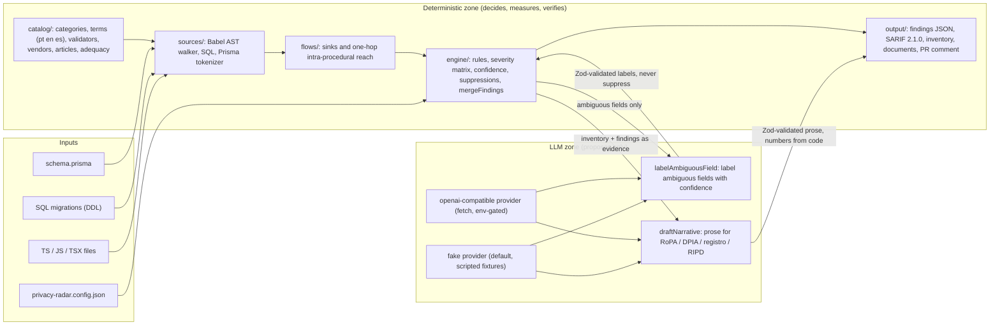

# Architecture

privacy-radar is layered, and the layers are enforced by tests. Everything inside the deterministic zone is pure code over data files; the two LLM boxes produce proposals that pass through Zod, an evidence check and `mergeFindings` before they touch any output. No arrow goes from the LLM to a severity, an article reference, a location or a suppression. This is not legal advice and not a complete assessment.

The same diagram lives in `docs/diagrams/architecture.mmd` and is rendered by `npm run diagrams:check`. The end-to-end demo flow is `docs/diagrams/demo-flow.mmd`.

## Components

| Layer | Files | Responsibility |
|---|---|---|
| Contracts | `src/contracts/*.ts` | Zod schemas and types for the catalog, config, source model, flows, findings, inventory, SARIF subset, LLM input and output, fake fixture and limits. No logic, no I/O. |
| Catalog | `catalog/*.json`, `src/catalog/{load,terms,values,index}.ts` | `load.ts` is the only reader of `catalog/`; `terms.ts` normalizes names and matches terms in pt, en and es; `values.ts` detects values, applies checksum validators with corroboration and masks. |
| Validators | `src/validators/*.ts` | Ten pure identifier checks (CPF, CNPJ, IBAN, PT NIF, ES DNI/NIE, IT codice fiscale, DE Steuer-ID, NL BSN, FR NIR, Luhn). |
| Sources | `src/sources/**` | `ts/` (Babel adapter, iterative walker, entities, functions and bindings), `sql/` (splitter and `pgsql-ast-parser`), `prisma/` (tokenizer). Each imports only its parser library and contracts; text is passed in. |
| Flows | `src/flows/{sinks,reach,vendors}.ts` | Sink matching, the one-hop reach model and vendor resolution by host suffix. |
| Engine | `src/engine/**` | Field classifier, ambiguous-field selection, the twelve rules, transfer assessment, severity matrix, confidence, suppressions, fingerprints, `mergeFindings`, masked-source re-slicing and message templates. |
| LLM | `src/llm/**`, `src/prompts/**` | Provider port, fake provider, OpenAI-compatible client, `callLlm`, the two tasks, narrative checks, trace and the versioned prompts. |
| Output | `src/output/**` | Findings JSON, SARIF, inventory, console table, Markdown escaping, document templates, renderer and sections, the demo hero. Pure: templates are read by `src/app/documents.ts`. |
| App | `src/app/{scan,documents,pr,llm}.ts` | Orchestration: one scan, documents, PR mode, provider factory. The only writers of outputs besides `scripts/`. |
| PR | `src/pr/{snapshot,diff,comment}.ts` | Changed files, full-tree snapshots of two revisions, multiset diff and compliance sentences. |
| Infra | `src/infra/**` | Config, logger, redaction, mask, files, Git, paths, errors, clock, version. |
| CLI | `src/cli.ts` | `node:util.parseArgs`, dispatch, exit codes; the only CLI port that reads `process.env`. |
| Scripts | `scripts/*.ts` | `demo`, `regen`, `eval`, `check-secrets`, `check-diagrams`, `check-catalog-freshness`, `rehash-fixtures`. |

## Dependency rules

1. `src/contracts/**` imports only `zod`.
2. Pure layers (`src/validators`, `src/catalog/{terms,values,index}.ts`, `src/flows`, `src/engine`, `src/output`, `src/shared`) import no `node:fs`, no `node:child_process`, no `src/llm`, no `src/app` and never read `process.env`. `src/engine/fingerprint.ts` imports `node:crypto`.
3. `src/sources/**` imports its parser library and `src/contracts`; no `node:fs`, no `src/llm`, no `src/engine`.
4. `src/llm/**` and `src/prompts/**` never import `src/engine`, `src/output`, `src/sources` or `src/app`. The LLM has no path to a severity, an article or a file.
5. Only `src/catalog/load.ts` reads `catalog/`; only `src/infra/files.ts` and `src/infra/git.ts` read the target; only `src/app/scan.ts`, `src/cli.ts` and `scripts/*.ts` write outputs.
6. Only `src/cli.ts`, `scripts/*.ts` and `src/infra/config.ts` read `process.env` (plus `src/infra/git.ts` for the `PATH` and `HOME` of its children).
7. Article references enter a finding only through `src/engine/rules/*.ts` reading the catalog index by rule, category and regime. No article word appears in `src/llm` or `src/prompts` except in `narrative-checks.ts` (which rejects citations) and the `SYSTEM` text that forbids them.
8. Erasable syntax only: no `enum`, `namespace`, parameter properties or decorators; classes only for errors. `tsc` checks this one.

Rules 1 to 7 are checked by `tests/unit/conventions.unit.test.ts` with an import scan over `import ... from` lines and text scans, and the test file has self-tests for the scanners. Mutation checks (a pure layer importing `node:fs`, an `src/llm` file importing the engine) were run once when the test was written and failed as expected.

## Masking pipeline

Source adapters parse the **raw** text and return structure plus offsets (`ValueHit.start/end`, `Field.commentRange/defaultRange`, `Binding.initRange`, `CallSite.urlRange`). `src/app/scan.ts` then runs `detectValues` and `maskText` (length-preserving: same length, same line breaks) and `applyMaskedText`, which re-slices every string of the model from the masked text. Every snippet, declaration line, comment, default value, LLM sample, fingerprint, message, PR sentence and document row is built from that masked copy, so no raw scanned text leaves `scan.ts`. Literals are masked by value pattern and also by the name they are bound to (`{ fullName: "Maria Souza" }` becomes `{ fullName: "Ma*** ***za" }`); an `INSERT` row that fails to parse has every literal masked. See ADR 0010 and `tests/e2e/no-leak.e2e.test.ts`.

## Who decides what

| Decision | Deterministic code | LLM | Criteria |
|---|---|---|---|
| Which fields hold personal data | Catalog terms (pt, en, es) + value patterns + checksum validators + context | labels only fields the engine marked ambiguous, with confidence, as `note` | CAT-*, VAL-*, ENG-03, LLM-02 |
| Category and sensitivity | Catalog (per regime where they differ) | proposes a label from the closed enum | ENG-01, LLM-02 |
| Where data flows (sinks, vendors, countries) | AST reach model, sinks catalog, vendor catalog, adequacy file | nothing | FLOW-*, ENG-05 |
| Severity | Matrix (sink × sensitivity) and fixed severities per rule | nothing; LLM findings are always `note` | ENG-02, LLM-05 |
| Article references | `catalog/rules.json` × category group × regime; `PR-AMBIGUOUS` has fixed articles whatever the label | nothing | CAT-06, ENG-04, LLM-12 |
| file:line | Parsers (Babel `loc`, SQL offsets → line table, Prisma tokenizer) | nothing | SRC-*, SCH-* |
| Suppression | Humans in `privacy-radar.config.json` with a reason | nothing | ENG-07, LLM-04 |
| Exit code | Deterministic findings vs `--fail-on` | nothing | OUT-07 |
| Transfer status | Adequacy file + config mechanism; worded "verify" | nothing | ENG-05 |
| Document tables, evidence index, DPIA trigger count, RIPD indicators, inventory counts | Inventory and findings with `origin: "deterministic"` only; LLM-labeled fields shown in a separate advisory column or sub-table | nothing | DOC-01 to DOC-04, DOC-09 |
| Document narrative paragraphs | validated (numbers from facts, article tokens from the section's deterministic list, cited ids exist) and labeled | writes them | DOC-05, DOC-06 |
| PR sentences and PR verdict | Template over the diff of two deterministic-only scans | nothing (PR mode makes no LLM call) | PR-03, PR-04 |
| Precision claims | Deterministic classifier eval against hand labels; LLM eval harness results; field-study counts and triage after the M9 run | nothing; the eval measures the model, the model never grades itself | EVAL-01, EVAL-02, EVAL-03 |
